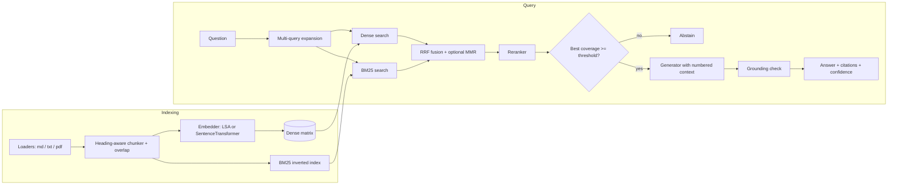

# RAG Pro - Advanced Retrieval-Augmented Generation

A compact, production-style RAG toolkit: heading-aware chunking, **hybrid retrieval** (BM25 + dense with
Reciprocal Rank Fusion), multi-query expansion, optional MMR diversity, reranking, **cited answers**, a
**grounding check**, **abstention** on out-of-scope questions, an evaluation harness with an ablation study,
a FastAPI service, CLI, Docker and CI.

Runs fully **offline** (no model downloads, no API key). Swap in sentence-transformers, a cross-encoder
reranker and an Anthropic LLM via optional extras.

## Architecture



| Component | File | Notes |
|---|---|---|
| Chunking | `rag_pro/chunking.py` | sentence packing, overlap, section heading prepended as context |
| Embeddings | `rag_pro/embeddings.py` | offline LSA (TF-IDF + SVD) or `sentence-transformers` |
| Lexical search | `rag_pro/bm25.py` | Okapi BM25 with inverted index |
| Fusion / diversity | `rag_pro/retrieval.py` | weighted RRF across retrievers *and* query variants, MMR, metadata filters |
| Reranking | `rag_pro/rerank.py` | lexical reranker (offline) or cross-encoder |
| Query expansion | `rag_pro/query.py` | keyword variant offline; LLM paraphrases when an LLM is configured |
| Generation | `rag_pro/generation.py` | extractive (offline) or LLM with citation + anti-injection prompt |
| Grounding | `rag_pro/grounding.py` | per-sentence support score, invalid-citation detection |
| Pipeline / persistence | `rag_pro/pipeline.py` | ingest, save/load, retrieve, query, per-stage timings |
| Service | `rag_pro/api.py` | `/health`, `/query`, `/ingest` |

## Quick start

```bash
git clone <your-repo-url> && cd rag-pro
python -m venv .venv && source .venv/bin/activate
pip install -e ".[dev]"            # extras: [pdf] [llm] [st]

rag-pro ingest data/sample_docs --index .index
rag-pro query "What constant is typical for reciprocal rank fusion?" --index .index
rag-pro query "What is the capital of France?" --index .index     # abstains
rag-pro serve --index .index        # http://127.0.0.1:8000/docs
```

```python
from rag_pro import RAGPipeline

pipe = RAGPipeline()
pipe.ingest_paths(["data/sample_docs"])
a = pipe.query("How do I enforce per-user document permissions?")
print(a.answer, a.confidence, a.grounded, [c.doc_id for c in a.citations])
```

API example:

```bash
curl -X POST localhost:8000/query -H 'content-type: application/json' \
  -d '{"question": "What does MRR measure?", "k": 3, "mode": "hybrid"}'
```

Docker: `docker build -t rag-pro . && docker run -p 8000:8000 rag-pro`

### Use a real LLM / better embeddings

```bash
pip install -e ".[llm,st]"
export ANTHROPIC_API_KEY=... RAG_GENERATOR=anthropic RAG_EMBEDDER=sentence-transformers
```

With an LLM configured, multi-query expansion also uses it to generate paraphrases, and answers are
generated from numbered passages with a "cite or say I don't know" prompt that treats context as untrusted.
Plug in `CrossEncoderReranker` via `RAGPipeline(reranker=...)`.

## Evaluation

`make eval` (or `python -m evaluation.run_eval`) runs an ablation over retrieval strategies plus end-to-end checks.
Latest run on the bundled corpus:

Corpus: 8 documents, 16 chunks. 18 answerable questions, 3 unanswerable.

### Retrieval ablation (document-level)

| Configuration | Recall@1 | Recall@3 | Recall@5 | MRR | nDCG@5 | ms/query |
|---|---|---|---|---|---|---|
| BM25 only | 0.86 | 0.94 | 0.94 | 0.92 | 0.92 | 0.1 |
| Dense (LSA) only | 0.81 | 0.94 | 0.94 | 0.89 | 0.90 | 0.5 |
| Hybrid (RRF) | 0.81 | 0.94 | 0.94 | 0.89 | 0.90 | 0.5 |
| Hybrid + rerank | 0.81 | 0.94 | 0.94 | 0.89 | 0.90 | 1.5 |
| Hybrid + rerank + multi-query | 0.81 | 0.94 | 0.94 | 0.89 | 0.90 | 1.9 |

### End-to-end (full pipeline, extractive generator)

| Metric | Value |
|---|---|
| Answered when answerable | 1.00 |
| Abstained when unanswerable | 1.00 |
| Answer keyword recall | 0.81 |
| Grounded answers | 1.00 |
| Answers with valid citations | 1.00 |

**Read these numbers honestly:** the bundled corpus is tiny (16 chunks), so every strategy retrieves well and the
extra stages (rerank, multi-query) show no gain here - they cost a little latency. The harness exists so you can
measure the same ablation on your own, larger corpus and QA set (edit `evaluation/dataset.py`). The sample
questions were also written by the same author as the documents, so treat 100% abstention/grounding as a smoke
test, not a benchmark. "Keyword recall" is a crude proxy for answer correctness; use an LLM judge or human review
for real quality claims.

## Design notes

- **RRF over raw scores:** BM25 and cosine scores are not comparable; ranks are.
- **Heading as context:** prepending section headings to chunks at index time improves retrieval of short chunks.
- **Abstention signal:** absolute query-term coverage of the best chunk (not the relative fused score, which is always 1.0 for the top hit).
- **Grounding check is a proxy:** lexical overlap catches fabricated content but not subtle contradictions; add NLI or an LLM judge for high stakes.
- **Security:** retrieved text is untrusted (indirect prompt injection). Pair with an input/output guard such as a LangGraph guardrail pipeline.
- **Persistence:** `embedder.pkl` is a pickle - only load indexes you built yourself.

## Limitations / next steps

Incremental indexing (currently rebuilds the index on each ingest), an ANN index (FAISS/HNSW) beyond ~100k chunks,
learned reranking, NLI-based faithfulness, query routing, streaming responses, auth and rate limiting on the API.

## Layout

```
rag_pro/       library (pipeline, retrieval, generation, grounding, api, cli)
data/          sample_docs/ (8 markdown files)
evaluation/    dataset.py  metrics.py  run_eval.py  results.md
tests/         17 tests
Dockerfile  Makefile  pyproject.toml  .github/workflows/ci.yml
```

MIT licensed.
